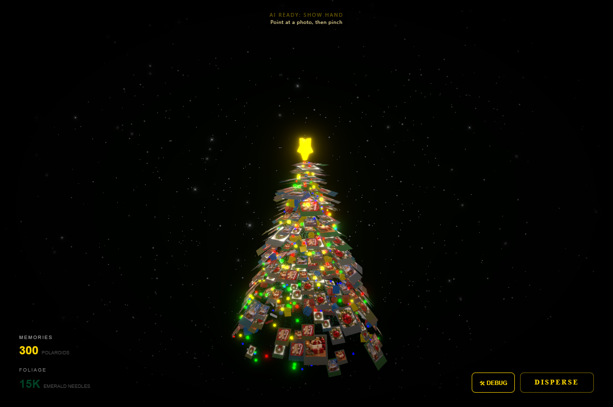

# 互动圣诞树

在浏览器里拼起一棵会发光的 3D 圣诞树。粒子、彩灯和圣诞拍立得可以聚成树，也可以散到星空中。树上的照片包括礼物、圣诞花环、姜饼、雪花球和红色挂饰，点开就能放大浏览。



## 启动

在项目目录安装依赖并启动开发服务器。

```bash
npm ci
npm run dev
```

打开终端显示的本地地址。点击 **Assemble Tree** 聚合，点击 **Disperse** 散开。拖动画面可以转动视角，滚轮可以缩放。点击树上的拍立得，或从左下角的 **Memories** 进入照片浏览。

运行 `npm run build` 会将生产文件输出到 `dist/`，随后可用 `npm run preview` 查看构建结果。

## 手势

在本机地址或 HTTPS 页面上授权摄像头。握拳聚合、张掌散开，左右移手可以旋转视角。选照片时，先用食指移动金色准星，再用拇指和食指捏合。看图时用食指横划翻页，张掌约半秒退出。

识别在浏览器本地进行。模型、照片和环境光素材随项目提供。完整手势和键盘操作见[中文手势使用指南](./手势使用指南.md)。

## 替换照片

支持 **PNG、JPG 和 JPEG**。把图片放入 `public/photos/`，然后在 [`src/App.tsx`](./src/App.tsx) 的 `bodyPhotoPaths` 中填写文件名，保留真实扩展名。例如 `gifts.png` 或 `winter.jpg`。如果沿用已有文件名，直接覆盖对应文件即可。

建议使用正方形图片。场景会将列表里的图片循环用在不同挂饰上，放大预览按列表顺序浏览。

## 技术与素材来源

项目使用 React、TypeScript、Vite、Three.js、React Three Fiber 和 MediaPipe。3D 场景基于[上游 Christmas Tree 项目](https://github.com/moleculemmeng020425/christmas-tree)，上游以 MIT 许可发布。

当前圣诞主题图由内置 imagegen 生成。环境光使用 Greg Zaal 的 [Dikhololo Night](https://polyhaven.com/a/dikhololo_night)（CC0）。手势识别使用 [Google MediaPipe Gesture Recognizer](https://developers.google.com/edge/mediapipe/solutions/vision/gesture_recognizer)。
